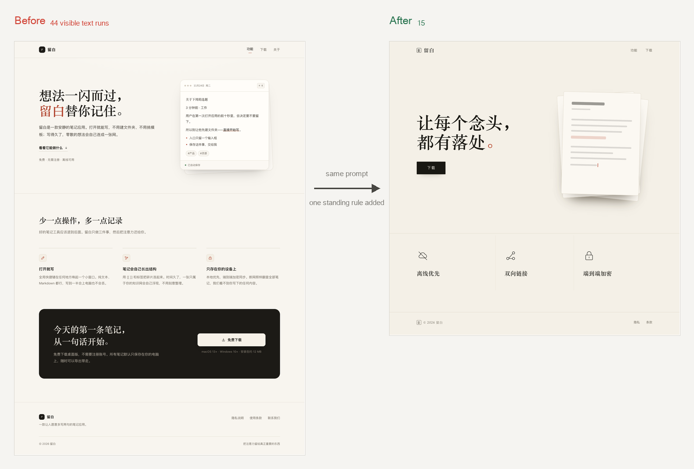
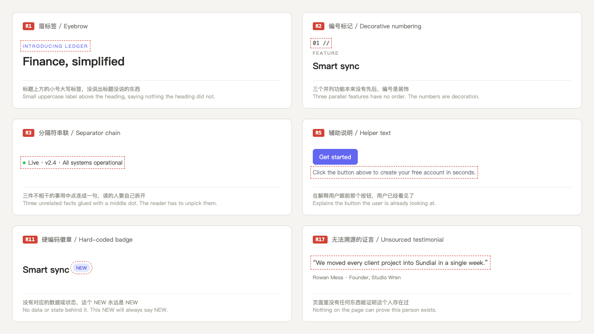
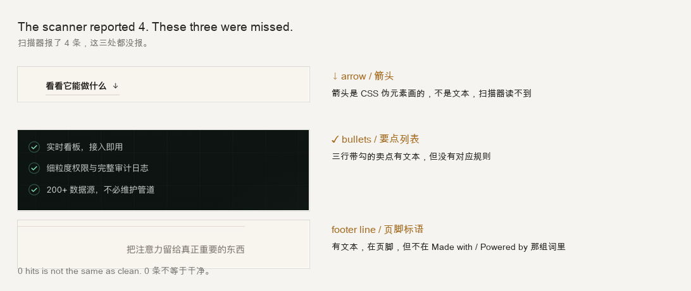

# quiet-ui

[中文](README.md) · **English** · [日本語](README.ja.md)

An Agent Skill that says no to defensive copy in web interfaces.

When AI writes a screen, it adds an explanation nobody asked for: in case you didn't understand, in case it looked like it did nothing, in case you didn't know the feature existed. Delete those sentences and the page still works.



Six screens, three configurations. With the rule, every page scores zero on the scanner, the page carries 40% less text, and the count of labels, buttons and table headers does not drop.

Six rules for writing, one checklist for cleaning up existing pages, one scanner that counts the hits. Interfaces only — docs, emails and blog posts are out of scope, explanation belongs there.

## Install

```bash
npx skills add y16689540962-cloud/quiet-ui -g
```

The skill installs as `quiet-ui` into your global skill directory. It follows the [Agent Skills](https://agentskills.io) standard, so Claude Code, Codex, Cursor, Gemini CLI and DSH pick it up.

No install needed either: send the repo link to an agent and tell it to read [`skills/quiet-ui/SKILL.md`](skills/quiet-ui/SKILL.md) first. The scanner sits at the repo root and runs as is. Both the skill and the scanner are written in Chinese; the rules are short enough that the section below stands on its own.

## Use

Once installed it applies whenever the agent builds or cleans up a screen. You can also name it:

```
Use quiet-ui to strip the copy in src/pages/landing.tsx
```

The scanner on its own:

```bash
python3 audit_copy.py page.html               # list the hits
python3 audit_copy.py src/pages --budget 1    # exit 1 over the budget, usable as a pre-commit check
python3 audit_copy.py src --json              # machine readable
python3 skills/quiet-ui/tests/run_tests.py    # scanner self-check
```

If a hit is wrong but justified (real state, legal text), add an `audit:ok` comment on that line and it is skipped.

On an existing page it states a verdict first — what gets deleted, what stays, what it cannot decide — then edits, then reports in a few lines.

## Rules

R1–R21, Python standard library, no dependencies. All 21 come down to one question: delete this string, can the user still finish the task. The six most common ones look like this, red boxes are what the scanner reported:



| Id | What it catches |
|---|---|
| R1 R2 | Eyebrow labels, `01 //` numbering |
| R3 | `·` `•` `\|` chains (data pairs and masked card numbers excluded) |
| R4 R10 | Subtitle under a heading, paragraph restating its own heading |
| R5 R19 | Helper text, tip boxes (errors, warnings and empty states exempt) |
| R6 R18 | Greetings, connectors like `or continue with` |
| R7 R8 | Marketing filler, numbers and endorsements with no source |
| R9 | The page describing itself ("this section explains…") |
| R11 R15 | Hard-coded badges, `<figcaption>` captions |
| R12 R13 R14 | Footer noise, Demo data tags, summary blocks |
| R16 | Placeholder repeating the label |
| R17 | Quoted testimonial with an attribution |
| R20 R21 | shadcn description components, arrows after labels |

## Calibration

Validate against a sample someone else made before measuring your own pages. `fixtures/` holds the before/after pair shipped with [felipebasurto/unslop-ui](https://github.com/felipebasurto/unslop-ui):

```
before-landing.html  tells=18  text_runs=24
after-landing.html   tells=0   text_runs=11
```

All 18 map one to one onto strings that repo's maintainer deleted himself. On this pair the scanner neither over- nor under-reports.

## Measurements

Six screens (dashboard, sign-in, settings, todo, game HUD, landing page), three configurations, six isolated subagents each. The only difference between configurations is whether the rule is present.

Round one used a version of the standing rule I had edited:

| Screen | A no rule | B rule standing | C rule + unslop-ui |
|---|---|---|---|
| Dashboard | 1 | 0 | 0 |
| Sign-in | 3 | 0 | 0 |
| Settings | 0 | 0 | 0 |
| Todo | 1 | 0 | 0 |
| Game HUD | 0 | 0 | 0 |
| Landing | 4 | 0 | 0 |
| Total | 9 | 0 | 0 |
| Visible text runs | 342 | 194 | 175 |

Round two swapped in the six rules verbatim and re-ran B/C:

| | Hits | Visible text runs | Reply length |
|---|---|---|---|
| B verbatim rules | 0 | 158 | 153–184 chars |
| C verbatim rules + unslop-ui | 0 | 152 | 282–1143 chars |

Arm A ran inside a window where the rule was temporarily removed (back up, remove, restore after, checksums matched); B and C ran with the rule standing.

The sign-in pair, three hits down to zero:


### Notes

- Without the rule: 1.5 hits per page, concentrated on landing and sign-in pages. Dashboards, settings and HUDs barely have this problem.
- With the rule: hits drop to zero, visible text runs fall 43%, and the count of `label`, button, table header and heading elements does not fall.
- Arm C replies grew to 2–7× arm B: unslop-ui requires a report of verdict, table and lists, which collides with the "one or two sentences" clause.
- One sample per cell. The gap is large, but it only shows direction.
- The first scanner reported 47 hits on arm A, 38 of them false positives (`12.4%` deltas, `Visa •••• 4242`, twelve month-axis labels, task tags). Comparison started after it came down to 9.

### Eyeball check

A scanner score of zero means it caught nothing, not that the page is clean. Four screenshots from `shots/` turned up three kinds of trace it cannot see:



The `uppercase` left in arm B is the product wordmark and table headers, `spark-dot` is a chart data point — none of it is a problem. That is also why the scanner is a ruler here, not a pass/fail line.

## Known limits

- Low recall. The arm-A landing page shows a dozen traces to the eye; the scanner reports 4.
- Pure heuristics, driven by class names and phrase lists. Swap in a different design system and it misses.
- Only usable for relative comparison. Absolute numbers are not an acceptance line.
- The Chinese phrase list is shorter than the English one, so Chinese pages score lower recall.
- JSX expressions are not parsed: `{t('key')}` is invisible, only literals are seen.
- "Real state" is decided from class names, so data-driven badges can still be false positives.

## Layout

```
audit_copy.py          R1–R21 scanner
assets/                figures used by the READMEs
fixtures/              calibration before/after (unslop-ui, MIT)
pilot/                 first A/B pair, including both versions of the "rule applied afterwards" file
matrix/                round one, 6×3
matrix2/               round two, B/C with the verbatim rules
shots/                 screenshots for the eyeball check
mark.py                annotates a page from scanner output, used to build the figures
scripts/               figure generation, plus the bilingual rule specimen page
skills/quiet-ui/       the skill: SKILL.md + scripts/audit_copy.py + tests/
README.md .en.md .ja.md   the readme in three languages
rule.md .en.md .ja.md     the standing rule in three languages
```

`~/.dsh/skills/quiet-ui` points at `skills/quiet-ui`, so editing the repo edits the live skill.

## License

MIT. `fixtures/` comes from felipebasurto/unslop-ui (MIT), unmodified.

Pages under `matrix/`, `matrix2/`, `pilot/` and `shots/` are model output kept as evidence, not designs meant to ship.
