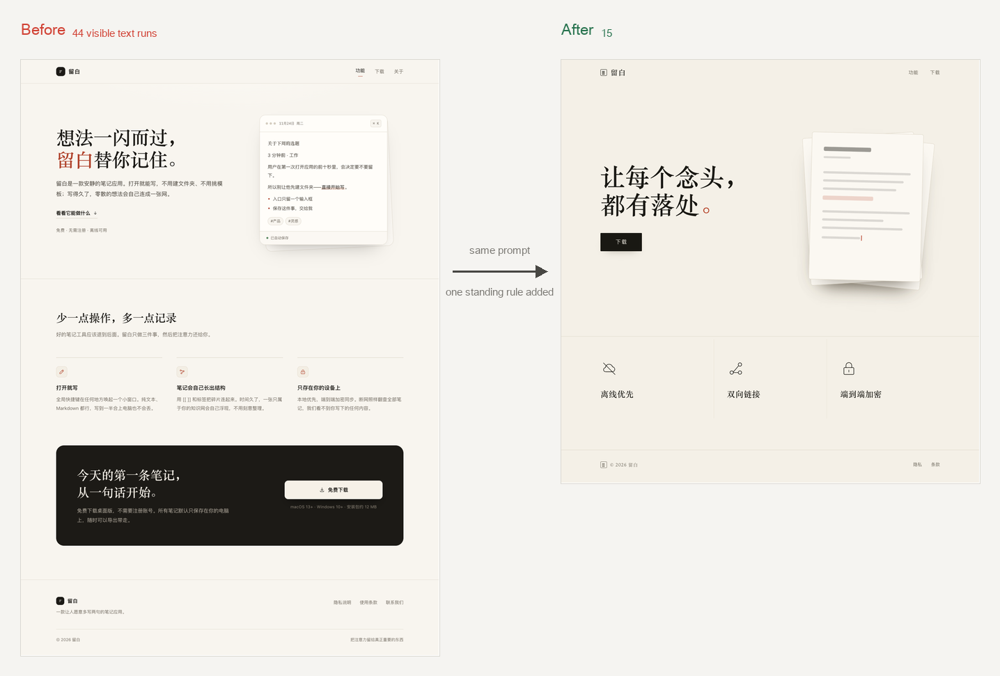
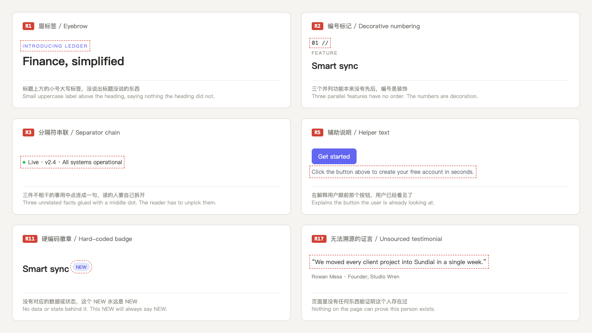
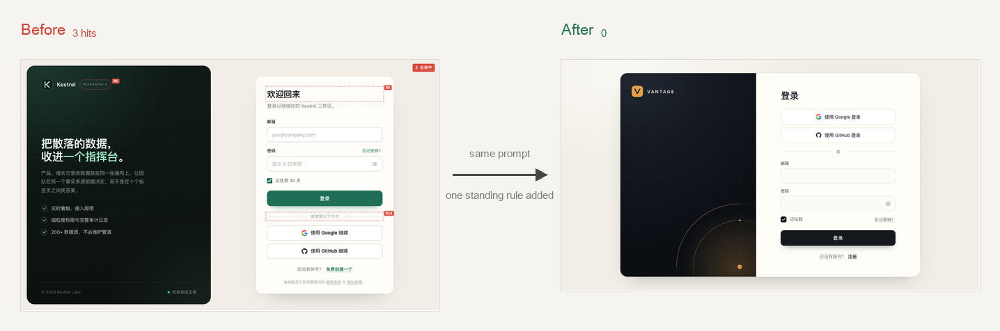
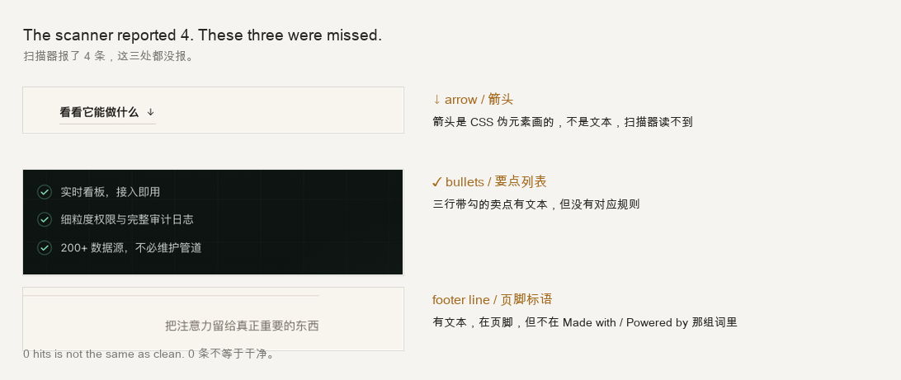

# quiet-ui

[中文](README.md) · [English](README.en.md) · **日本語**

Web インターフェースの「防衛的な説明」に no を突きつける Agent Skill です。

AI に画面を作らせると、必ず一言添えてきます。分からなかったらどうしよう、何もしていないと思われたらどうしよう、この機能に気づかなかったらどうしよう、という理由で。その一文を消しても、画面はそのまま使えます。



6 つの画面、3 つの構成で回しました。ルールを足すと、スキャナ上はどの画面もゼロ、ページの文字量は 4 割減、ラベルやボタンの数は減っていません。

書くとき用の 6 つのルール、既存ページを片付けるとき用のチェックリスト、当たりを数えるスキャナ。対象はインターフェースだけです。ドキュメント、メール、ブログは対象外で、そこでは説明が必要です。

## インストール

```bash
npx skills add y16689540962-cloud/quiet-ui -g
```

スキル名は `quiet-ui` で、グローバルのスキルディレクトリに入ります。[Agent Skills](https://agentskills.io) 規格に沿っているので、Claude Code、Codex、Cursor、Gemini CLI、DSH から認識されます。

インストールしなくても使えます。リポジトリのリンクをエージェントに渡して、[`skills/quiet-ui/SKILL.md`](skills/quiet-ui/SKILL.md) を先に読ませてください。スキャナはリポジトリ直下にあり、そのまま動きます。スキル本体とスキャナは中国語で書かれていますが、ルールは短いので下の節だけで意味は通ります。

## 使い方

インストール後は、画面を作るとき、既存ページを片付けるときに自動で効きます。名前を出して呼ぶこともできます。

```
quiet-ui で src/pages/landing.tsx の文言を片付けて
```

スキャナだけを回す場合：

```bash
python3 audit_copy.py page.html               # 当たりを一覧
python3 audit_copy.py src/pages --budget 1    # 予算超過で終了コード 1、コミット前チェックに使える
python3 audit_copy.py src --json              # 機械可読
python3 skills/quiet-ui/tests/run_tests.py    # スキャナの自己テスト
```

当たりが誤りでも理由がある場合（実際の状態、法的表記）は、その行に `audit:ok` とコメントすれば飛ばします。

既存ページでは、まず判定（どこを消すか、何を残すか、どれは判断できないか）を出し、そのあと編集し、最後に短い報告を返します。

## ルール

R1–R21。Python 標準ライブラリのみで依存なし。21 個すべての背景にある判断は一つです — これを消して、ユーザーはまだ目的を達成できるか。よく出る 6 つはこんな形です。赤い枠はスキャナが報告した位置です。



| ID | 拾うもの |
|---|---|
| R1 R2 | アイブロウラベル、`01 //` の番号 |
| R3 | `·` `•` `\|` の連結（データの対、マスク済みカード番号は除外） |
| R4 R10 | 見出し直下のサブタイトル、見出しを繰り返す段落 |
| R5 R19 | 補助説明、ヒントボックス（エラー・警告・空状態は除外） |
| R6 R18 | 挨拶、`or continue with` のようなつなぎ言葉 |
| R7 R8 | マーケティング的な空句、出所のない数字と推薦 |
| R9 | 画面が自分を説明する文（「この節では…」） |
| R11 R15 | 固定のバッジ、`<figcaption>` のキャプション |
| R12 R13 R14 | フッターの余計な文、Demo data タグ、末尾のまとめ |
| R16 | ラベルを繰り返すプレースホルダー |
| R17 | 引用符付きの証言と肩書き |
| R20 R21 | shadcn の description コンポーネント、ラベルの後ろの矢印 |

## 校正

自分で測る前に、他人が作った見本で検証します。`fixtures/` は [felipebasurto/unslop-ui](https://github.com/felipebasurto/unslop-ui) が同梱しているビフォー・アフターの一組です。

```
before-landing.html  tells=18  text_runs=24
after-landing.html   tells=0   text_runs=11
```

18 件はすべて、あのリポジトリの作者自身が消した文字列と一対一で対応します。この組では取りこぼしも過剰検出もありません。

## 計測

6 つの画面（ダッシュボード、ログイン、設定、ToDo、ゲーム HUD、ランディング）、3 つの構成、それぞれ 6 体の互いに見えないサブエージェント。構成の違いはルールがあるかどうかだけです。

1 回目は、私が書き換えた版の常設ルールを使いました。

| 画面 | A ルールなし | B ルール常設 | C ルール + unslop-ui |
|---|---|---|---|
| ダッシュボード | 1 | 0 | 0 |
| ログイン | 3 | 0 | 0 |
| 設定 | 0 | 0 | 0 |
| ToDo | 1 | 0 | 0 |
| ゲーム HUD | 0 | 0 | 0 |
| ランディング | 4 | 0 | 0 |
| 合計 | 9 | 0 | 0 |
| 表示テキスト数 | 342 | 194 | 175 |

2 回目はルールを原文の 6 条に戻して B/C を再実行しました。

| | 当たり | 表示テキスト数 | 返答の長さ |
|---|---|---|---|
| B 原文ルール | 0 | 158 | 153–184 文字 |
| C 原文ルール + unslop-ui | 0 | 152 | 282–1143 文字 |

A 群はルールを一時的に外した時間帯に実行しました（退避、削除、実行後に復元、チェックサム一致）。B/C はルール常設のままです。

ログイン画面の一組、3 件がゼロになりました。



### 補足

- ルールなしでは 1 ページあたり 1.5 件。ランディングとログインに集中し、ダッシュボード・設定・HUD にはほぼ出ません。
- ルールを足すと当たりはゼロ、表示テキストは 43% 減。`label`、ボタン、テーブルヘッダ、見出しの数は減っていません。
- C 群の返答は B 群の 2〜7 倍に膨らみました。unslop-ui が「判定＋表＋リスト」の報告を要求し、「返答は一、二文」という条項と衝突するためです。
- 各セル 1 サンプル。差は大きいですが、示せるのは方向だけです。
- 最初のスキャナは A 群で 47 件を報告し、うち 38 件は誤検出でした（`12.4%` の変化率、`Visa •••• 4242`、12 か月分の軸ラベル、タスクのタグ）。9 件まで減らしてから比較を始めています。

### 目視チェック

スキャナの 0 件は「何も拾わなかった」という意味で、画面がきれいという意味ではありません。`shots/` の 4 枚を見て、見えない痕跡が 3 種類ありました。



B 群に残った `uppercase` は製品のワードマークとテーブルヘッダ、`spark-dot` はグラフのデータ点で、どちらも問題ではありません。だからここではスキャナを物差しとして使い、合格判定には使っていません。

## 既知の制限

- 再現率が低い。ルールなしのランディングは目で見て十数か所ありますが、スキャナは 4 件しか報告しません。
- 純粋なヒューリスティックで、クラス名と語句リストに依存します。デザインシステムが変われば取りこぼします。
- 相対比較にだけ使えます。絶対値を合格ラインにはできません。
- 中国語の語句リストは英語より短いため、中国語ページは再現率が下がります。
- JSX 式は解析しません。`{t('key')}` のような動的な文言は見えず、リテラルだけが見えます。
- 「実際の状態」はクラス名で判定するため、データ由来のバッジでも誤検出になり得ます。

## 構成

```
audit_copy.py          R1–R21 スキャナ
assets/                README で使う図
fixtures/              校正用のビフォー・アフター（unslop-ui、MIT）
pilot/                 最初の A/B。ルールが後から効いた 2 版を含む
matrix/                1 回目、6×3
matrix2/               2 回目、B/C（ルールは原文に戻した）
shots/                 目視チェック用のスクリーンショット
mark.py                スキャナ出力からページを自動注釈し、図を作る
scripts/               図の生成スクリプトと、バイリンガルのルール見本ページ
skills/quiet-ui/       スキル本体：SKILL.md + scripts/audit_copy.py + tests/
README.md .en.md .ja.md   3 言語の説明
rule.md .en.md .ja.md     常設ルール、3 言語
```

`~/.dsh/skills/quiet-ui` は `skills/quiet-ui` を指しているので、リポジトリを直せば有効なスキルも直ります。

## ライセンス

MIT。`fixtures/` は felipebasurto/unslop-ui（MIT）から取得し、改変していません。

`matrix/`、`matrix2/`、`pilot/`、`shots/` の各ページはモデルが生成した計測用の産物で、リリースできるデザインではありません。
