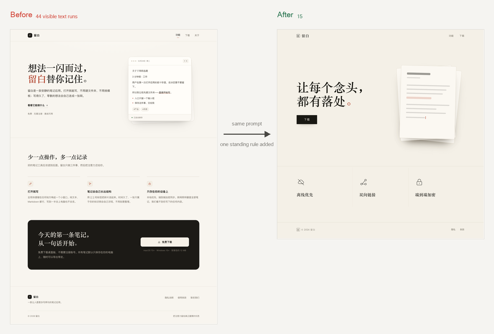
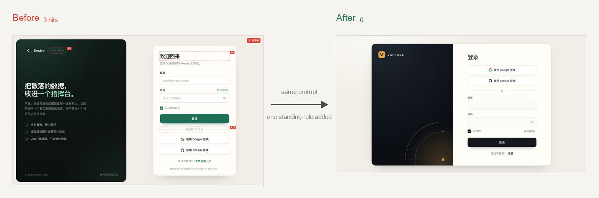
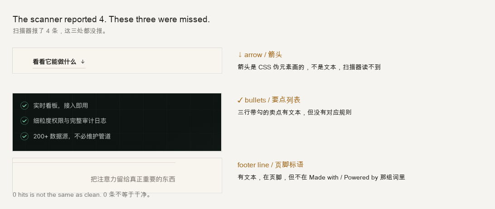

# quiet-ui

**中文** · [English](README.en.md) · [日本語](README.ja.md)

一个 Agent Skill，和防御性编程式的网页文案说不。

AI 写界面时习惯补一句解释：怕你没看懂，怕你觉得它没干活，怕你不知道这个功能存在。这些话删掉，页面照样能用。



六个界面、三种配置跑完：加上这条规则，扫描器口径下每页归零，整页文字少了四成，标签和按钮没有少。

六条规则管「写的时候别写」，一份清单管「旧的怎么删」，扫描器把命中的位置数出来。只管界面：文档、邮件、博客不适用，那里该解释就得解释。

## 安装

```bash
npx skills add y16689540962-cloud/quiet-ui -g
```

装上的技能叫 `quiet-ui`，进全局 skill 目录，按 [Agent Skills](https://agentskills.io) 标准被 Claude Code、Codex、Cursor、Gemini CLI、DSH 这类客户端识别。

不装也能用：把仓库链接发给 agent，让它读 [`skills/quiet-ui/SKILL.md`](skills/quiet-ui/SKILL.md) 再动手。扫描器就在根目录，不用安装。

## 用

装上之后，让它做页面或清理旧页面时会自动适用。也可以直接点名：

```
用 quiet-ui 清理 src/pages/landing.tsx 的文案
```

扫描器单独跑：

```bash
python3 audit_copy.py page.html               # 列出命中的标记
python3 audit_copy.py src/pages --budget 1    # 超过 1 条退出码 1，可当提交前检查
python3 audit_copy.py src --json              # 机器可读
python3 skills/quiet-ui/tests/run_tests.py    # 扫描器自检
```

某条报得不对、但确有理由（真实状态、法律文字），在那一行加 `audit:ok` 注释即可放行。

清理旧页面时它先给判定（删几处、留哪些、哪些要你决定），再动手改，改完给一份简短报告。

## 规则

R1–R21，Python 标准库，无依赖。21 条背后是同一句判断：删掉它，用户还能完成任务吗。最常见的六条长这样，红框是扫描器报的位置：


| 编号 | 抓什么 |
|---|---|
| R1 R2 | 眉标签、`01 //` 编号 |
| R3 | `·` `•` `\|` 串联（数据对、掩码卡号已排除） |
| R4 R10 | 标题下的副标题、复述标题的段落 |
| R5 R19 | 辅助说明、提示框（错误/警告/空状态豁免） |
| R6 R18 | 问候语、`or continue with` 这类衔接词 |
| R7 R8 | 营销套话、无出处的数字与背书 |
| R9 | 页面自我描述（"本节说明…"） |
| R11 R15 | 硬编码徽章、`<figcaption>` 图注 |
| R12 R13 R14 | 页脚废话、Demo data 标签、底部小结 |
| R16 | placeholder 重复 label |
| R17 | 引号证言 + 头衔署名 |
| R20 R21 | shadcn 描述组件、按钮后的箭头 |

## 校准

拿别人做好的样本验一遍，再用来量自己的页面。`fixtures/` 是 [felipebasurto/unslop-ui](https://github.com/felipebasurto/unslop-ui) 仓库自带的一对 before/after：

```
before-landing.html  tells=18  text_runs=24
after-landing.html   tells=0   text_runs=11
```

18 条逐条对应该仓库维护者自己删掉的字符串。在这对样本上不漏报也不误报。

## 实测

6 个界面场景（仪表盘、登录页、设置页、待办、游戏 HUD、落地页），三种配置，每种 6 个互不可见的子代理。三种配置唯一的区别是有没有那条规则。

第一轮，常驻规则用的是我改写过的版本：

| 页面 | A 无规则 | B 规则常驻 | C 规则 + unslop-ui |
|---|---|---|---|
| 仪表盘 | 1 | 0 | 0 |
| 登录注册 | 3 | 0 | 0 |
| 设置页 | 0 | 0 | 0 |
| 待办 | 1 | 0 | 0 |
| 游戏 HUD | 0 | 0 | 0 |
| 落地页 | 4 | 0 | 0 |
| 合计 | 9 | 0 | 0 |
| 可见文字段 | 342 | 194 | 175 |

第二轮，规则换成方案原文的 6 条，重跑 B/C：

| | 标记 | 可见文字段 | 回复长度 |
|---|---|---|---|
| B 规则原文 | 0 | 158 | 153–184 字符 |
| C 规则原文 + unslop-ui | 0 | 152 | 282–1143 字符 |

A 臂在临时移除规则的窗口里跑（备份、移除、跑完恢复，校验和一致），B/C 在规则常驻下跑。

登录页那一对，3 处降到零：



### 说明

- 无规则时每页 1.5 条，集中在落地页和登录页。仪表盘、设置页、HUD 基本没有这个问题。
- 加规则后标记清零，可见文字段减少 43%，`label`、按钮、表头、标题的数量没有下降。
- C 臂的回复涨到 B 臂的 2–7 倍：unslop-ui 要求交"判定 + 表格 + 清单"的报告，和"回复一两句话"这条规则冲突。
- 每格只有 1 个样本。差异很大，但只能说明方向。
- 第一版扫描器在 A 臂上报了 47 条，其中 38 条是误报（`12.4%` 涨幅、`Visa •••• 4242`、12 个月份轴标签、任务标签）。修到 9 条之后才开始比。

### 人眼复核

扫描器报 0 条只说明它没抓到，不说明页面干净。拿 `shots/` 的四张截图看了一遍，三类痕迹它看不见：



B 臂里剩下的 `uppercase` 是产品 wordmark 和表头，`spark-dot` 是图表数据点，都不算问题。这也是为什么这里只把扫描器当尺子，不当验收线。

## 已知限制

- 召回不高。无规则那臂的落地页肉眼能看出十来处，扫描器只报 4 条。
- 纯启发式，靠类名和短语表。换一套设计系统就会漏。
- 只适合做相对比较，绝对值不可当验收线。
- 中文短语表比英文短，中文页面召回率更低。
- 不解析 JSX 表达式，`{t('key')}` 这类动态文案看不到。
- 判"真实状态"靠类名，数据驱动的徽章也会误报。

## 目录

```
audit_copy.py          R1–R21 扫描器
assets/                README 用的对比图
fixtures/              校准用的 before/after（unslop-ui，MIT）
pilot/                 第一组 A/B，含规则事后生效的两版
matrix/                第一轮 6×3
matrix2/               第二轮 B/C（规则换回原文）
shots/                 人眼复核截图
mark.py                按扫描器输出自动标注页面，用来生成对比图
scripts/               生成图的脚本，以及双语规则示例页
skills/quiet-ui/       兜底 skill：SKILL.md + scripts/audit_copy.py + tests/
README.md .en.md .ja.md   三种语言的说明
rule.md .en.md .ja.md     常驻规则，三种语言
```

`~/.dsh/skills/quiet-ui` 指向 `skills/quiet-ui`，改仓库即改生效的 skill。

## 许可

MIT。`fixtures/` 取自 felipebasurto/unslop-ui（MIT），未修改。

`matrix/`、`matrix2/`、`pilot/`、`shots/` 里的页面是模型生成的评测产物，不是可上线的设计。
